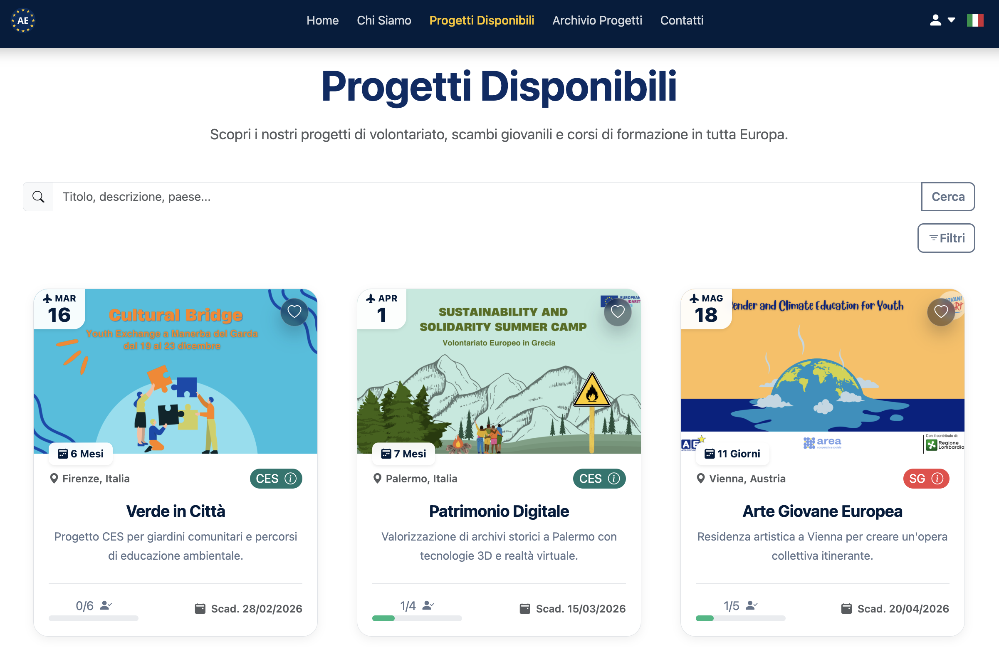
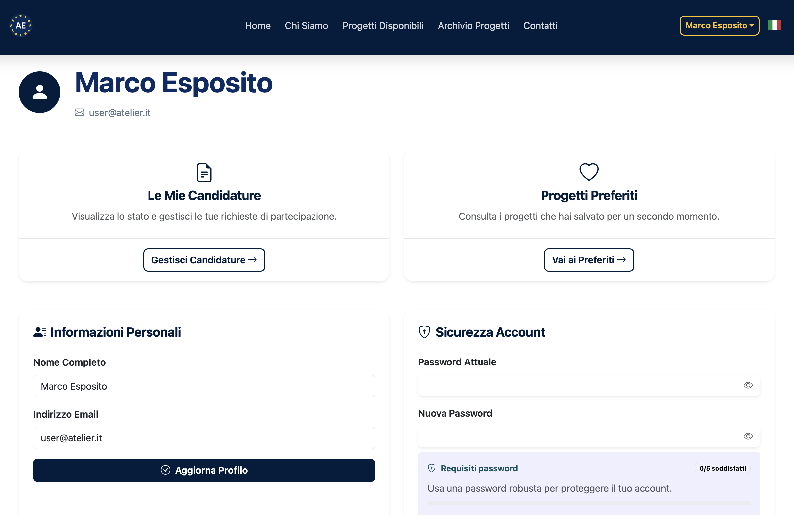
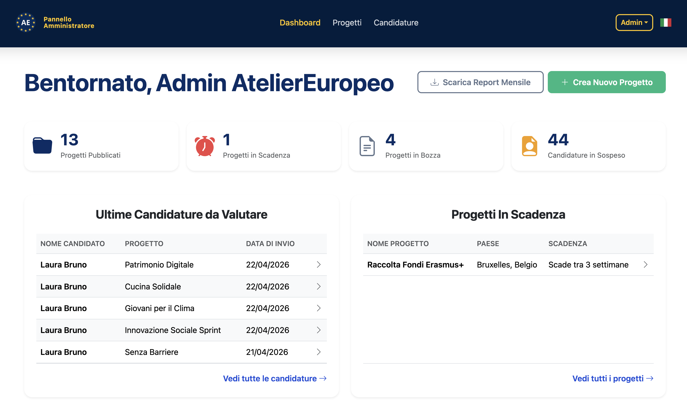

<div align="center">
  

# Atelier Europeo IPC

Web portal to browse, apply for and manage European mobility projects.


</div>

Atelier Europeo is a Laravel application built as a university project for the Web Programming and Human-Computer Interaction courses. Users explore programmes such as the European Solidarity Corps, youth exchanges and training courses, save favourites and apply with a PDF. Administrators publish projects and review applications.

## Screenshots

| Public catalog | User panel | Admin dashboard |
| :---: | :---: | :---: |
|  |  |  |

## Features

- **Project catalog** with full-text search and filters for category, duration and start date, plus a portfolio of completed projects with testimonials.
- **Project lifecycle** (`draft` → `published` → `completed`) with enforced one-way transitions, live preview before saving, and bulk status updates.
- **Applications** with phone number and PDF upload. Users can track status and withdraw while pending.
- **Admin review** with approve/reject messages. Approvals are capped at the number of requested participants, and each decision records which admin made it and when.
- **Favorites** toggled via AJAX.
- **Role-based access** for guests, registered users and admins, with an admin-to-user view switch.
- **Localization** through a session-based middleware and a language selector. Italian and English are complete; Spanish and French cover the main layout only.
- **Rich text sanitization** for project descriptions edited by admins.

## Getting started

### Prerequisites

- PHP 8.2+ and Composer
- Node.js 18+ and npm

### Installation

```bash
git clone https://github.com/SickCiQuattro/AtelierEuropeo_IPC.git
cd AtelierEuropeo_IPC

composer install
cp .env.example .env
php artisan key:generate

touch database/database.sqlite
php artisan migrate --seed

php artisan storage:link
npm install
```

Start the app with the server, queue worker, logs and Vite together:

```bash
composer run dev
```

Then open <http://localhost:8000>.

> [!TIP]
> SQLite is the default. To use MySQL, set `DB_CONNECTION=mysql` and the `DB_*` variables in `.env` before running the migrations.

### Demo accounts

The seeders also create projects, applications, testimonials and favorites. Seeded accounts use the password `password`:

| Role | Email |
| --- | --- |
| Admin | `admin@atelier.it` |
| User | `user@atelier.it` |

> [!WARNING]
> These credentials are for local development only.

## Development

```bash
php artisan test        # Pest test suite (in-memory SQLite)
./vendor/bin/pint       # code style
npm run build           # production assets
```

## Project structure

```
app/
  Http/Controllers/    Public pages, projects, applications, favorites, admin panels
  Http/Middleware/     Admin guard, locale switching, draft-access check
  Models/              Eloquent models and DataLayer (query helpers for the home page and forms)
  Helpers/             Rich text sanitizer, localization helpers
database/              Migrations, factories, seeders
resources/lang/        it, en (full), es, fr (layout only)
resources/views/       Blade templates (public, user, admin)
tests/                 Pest feature and unit tests
```

## Tech stack

Laravel 12 · Blade · Tailwind CSS · Alpine.js · Bootstrap 5 and Bootstrap Icons · Vite · Laravel Breeze · Pest · Laravel Pint
